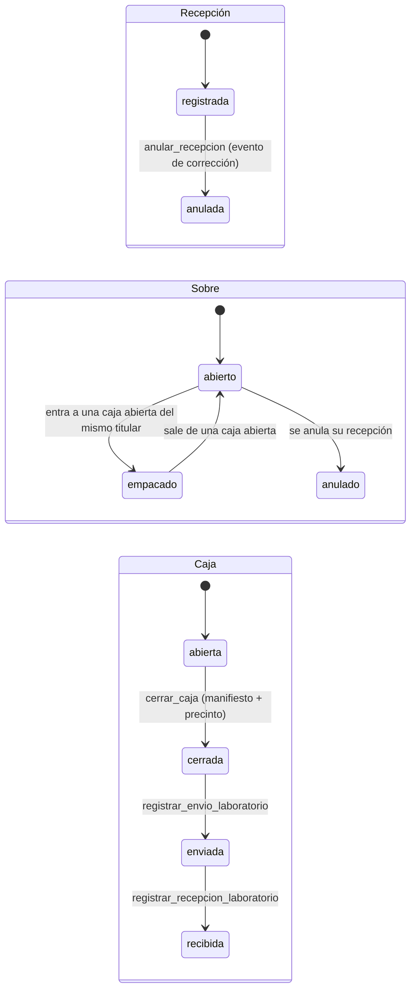

# Flujo de recepción física y cadena de custodia hasta el laboratorio

Documento **interno**. Describe lo implementado en la migración 047, en
`lib/recepcion/*` y en `/api/recepcion/*`. Todo lo registra el **personal**; el
titular y las organizaciones solo ven.

No hay pagos, recibos, montos ni precio en ningún paso. Quién opera la
recepción y si el flujo es compraventa o logística está **[POR CONFIRMAR]**: el
operador de recepción, la parte compradora y el laboratorio de destino son
papeles configurables (`partes_flujo`), no nombres en código.

## 1. Pasos y evento que emite cada uno

Cada paso deja un evento en `lote_eventos`, encadenado por hash con el mismo
canónico de la 043 (no cambió).

| # | Paso | Quién | Dónde se registra | Evento |
|---|---|---|---|---|
| 1 | Llegada del material (en persona, encargo expreso, DHL u otro) | recepción | `recepciones.modo_entrega`, `guia` | — (parte del paso 2) |
| 2 | Recepción registrada: punto, fecha, receptor, titular de origen, mina, embalaje, observaciones | recepción | `recepciones` | `recepcion` |
| 3 | Pesaje: peso bruto y neto, instrumento, fecha de calibración | recepción | `sobres` | `pesaje` |
| 4 | Análisis: ley como fracción 0–1 (sin calcular precio) | recepción | `sobres.ley_fino` | `analisis` |
| 5 | Etiquetado por origen: etiqueta y número de sello ya existente | recepción | `sobres.etiqueta`, `numero_sello` | `etiquetado` |
| 6a | Sobre por mina | recepción | `sobres` | `empaque_sobre` |
| 6b | Caja con manifiesto y precinto | recepción | `cajas` (función `cerrar_caja`) | `empaque_caja` |
| 7 | Envío o entrega al laboratorio: medio, guía, fecha, responsable | recepción | `envios_laboratorio` | `envio_laboratorio` |
| 8 | Recepción en laboratorio y conciliación de pesos contra el manifiesto | recepción | `recepciones_laboratorio` | `recepcion_laboratorio` |
| — | Anulación de una recepción | recepción | función `anular_recepcion` | `correccion` |

"recepción" = rol `recepcion` (o `admin`). `verificador`, `abogado` y
`tecnico_ambiental` solo consultan. El rol `recepcion` con organización asignada
opera únicamente los puntos de esa organización.

Los tipos `fundicion`, `refinado` y `pago` de la 043 siguen existiendo y no se
usan en este flujo. El registro manual de eventos
(`/api/cadena/lotes/[id]/eventos`) no acepta los tipos de recepción.

## 2. Estados

Una caja cerrada no se modifica: ni su manifiesto ni sus sobres.

## 3. Reglas de integridad

Están en la base (triggers y funciones de la 047) y replicadas en
`lib/recepcion/reglas.ts` para dar el mensaje antes de llegar a la base.

| Regla | Dónde se impone |
|---|---|
| (a) Un sobre pertenece a una sola mina, la de su recepción | `fn_sobre_integridad` · `sobreAdmisible` |
| (b) Una caja contiene sobres de un solo titular de origen: lotes de titulares distintos nunca se mezclan | `fn_sobre_integridad`, `cerrar_caja` · `puedeEmpacar` |
| (c) No se cierra una caja sin manifiesto | CHECK `cajas_manifiesto_check`, `cerrar_caja` · `puedeCerrarCaja` |
| (d) No se cierra ni se envía una caja con sobres sin pesar o sin etiquetar | `fn_sobre_integridad`, `cerrar_caja`, `registrar_envio_laboratorio` · `puedeEnviarCaja` |
| (e) Un titular sin perfil aprobado no origina recepción | `fn_recepcion_alta` · `recepcionAdmisible` |
| (f) Nada se borra; la anulación es un evento de corrección | triggers de inmutabilidad + `revoke delete` · `puedeAnularRecepcion` |
| La mina es del mismo titular que el lote (cada mina con su expediente) | `fn_recepcion_alta` |
| Los eventos de recepción solo los emite el personal | `fn_lote_evento_reservar_recepcion` |

## 4. Manifiesto

`lib/recepcion/manifiesto.ts` genera el manifiesto de forma determinista: mismo
contenido, mismo JSON canónico, mismo SHA-256, sin importar el orden de los
sobres ni el formato de los pesos. Contiene código de caja, precinto, punto,
laboratorio de destino, titular de origen y, por sobre: etiqueta, número de
sello, mina, lote y peso neto. No contiene precios, montos ni datos personales.

`cerrar_caja` comprueba que la huella corresponde al texto y que el manifiesto
lista exactamente los sobres de la caja con sus pesos. La vista imprimible está
en `/dashboard/recepcion/cajas/[id]`.

## 5. Conciliación en laboratorio

Se compara, sobre por sobre, el peso recibido contra el del manifiesto, con el
mismo umbral de la 043 (`umbral_conciliacion_peso_pct`), que **no tiene valor por
defecto**.

| Situación | Resultado | Efecto |
|---|---|---|
| Umbral sin configurar | `umbral_no_configurado` | Nada se da por conciliado; alerta `umbral_no_configurado` en cada lote |
| Falta el peso de algún sobre | `incompleto` | — |
| Alguna diferencia supera el umbral, o el precinto llegó alterado | `discrepancia` | Alerta `conciliacion_peso` |
| Todo dentro del umbral y precinto íntegro | `conciliada` | — |

`conciliar_lote()` de la 043 compara cuatro puntos fijos del lote y no conoce
manifiestos; por eso la conciliación contra el manifiesto vive en
`registrar_recepcion_laboratorio`, con la misma regla y el mismo umbral.

## 6. Lo que este flujo no decide

- Quién opera la recepción física y quién es la parte compradora.
- El umbral de conciliación y las tolerancias de balanza.
- Si el lote de la 043 (que exige una fuente de una organización de tipo
  comercializador) sigue siendo el modelo correcto cuando el operador de la
  recepción no es un comercializador.
