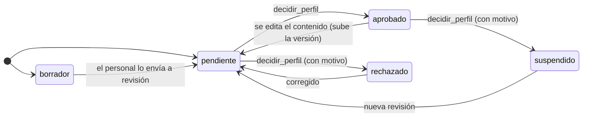
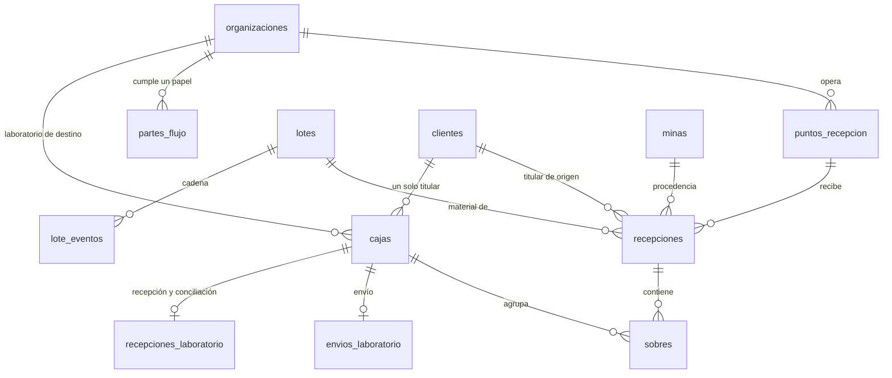

# Modelo de datos de la reestructura (migraciones 045 a 049)

Documento **interno**. Ninguna de estas migraciones está aplicada en
producción. Todas llevan la cabecera `NO APLICAR`, RLS en cada tabla,
`search_path` fijo en cada función `SECURITY DEFINER` y plan de reversa.

## 045 — Acceso por OTP y roles

| Objeto | Qué es | Notas |
|---|---|---|
| `user_roles.rol` (CHECK) | Se agregan `verificador` y `recepcion` | No se renombra ningún rol existente |
| `fn_user_roles_validar_org` | Los roles nuevos pueden llevar organización, de cualquier tipo | Regla de la 043 intacta para comercializador, planta y auditor |
| `has_role(uid, rol)`, `es_personal()` | Ayudantes para las policies | |
| `bitacora_acciones` | Bitácora de acciones del personal | Solo agregar. Actor, rol, organización, fecha, resumen sin datos personales |
| `fn_user_roles_bitacora` | Todo cambio de rol deja asiento | |
| `auth_otp_control` | Control del código de un solo uso | Sin columna para el código. Identificada por HMAC del correo. Solo `service_role` |
| `auth_otp_auditoria` | Auditoría de solicitudes y verificaciones | Solo agregar. Sin código ni correo en claro |
| `auth_otp_registrar_intento` | Cuenta un intento de forma atómica | Los límites llegan como argumentos |
| `auth_usuario_id_por_correo` | ¿Existe la cuenta? | Solo `service_role`: evita que emitir un código cree usuarios |
| `solicitudes_acceso` | Solicitudes de la página pública | Solo correo y nombre de contacto |

## 046 — Perfiles y aprobación

| Objeto | Qué es | Notas |
|---|---|---|
| `perfiles` | Perfil de un minero/productor o de una organización | Nace pendiente o borrador; nunca aprobado. Sin borrado |
| `aprobaciones_perfil` | Bitácora de decisiones | Solo agregar, con hash encadenado por perfil y la huella de la versión decidida |
| `decidir_perfil()` | Única vía para aprobar, rechazar o suspender | Una decisión por llamada. Quien creó o editó no decide |
| `lote_exigir_perfil_aprobado` | Trigger sobre `lotes` | Un lote solo nace de un titular con perfil aprobado |
| `licencias_mina` | Estado y vigencia de licencias por mina | Lo carga el personal |
| `cliente_del_usuario()`, `es_titular_de_mina()` | Base de "el titular solo ve lo suyo" | |

Estados de un perfil:

## 047 — Recepción y custodia

Ver `flujo-recepcion.md`. Tablas: `puntos_recepcion`, `partes_flujo`,
`recepciones`, `sobres`, `cajas`, `envios_laboratorio`,
`recepciones_laboratorio`. Amplía dos CHECK existentes (tipos de evento y tipos
de organización) sin quitar valores.

Ninguna de estas tablas concede INSERT ni UPDATE a usuarios autenticados: toda
la carga pasa por la API con el cliente de servicio y los predicados de
`lib/acceso/personal.ts`. La lectura sí tiene policies: el personal (acotado por
punto para `recepcion`), el auditor y el titular sobre lo suyo.

## 048 — Organizaciones, membresías e invitaciones

| Objeto | Qué es | Notas |
|---|---|---|
| `organizaciones.tipo` | Una sola entidad con `tipo` | Se suman cooperativa, municipio y otro (declarados en el CHECK de la 047) |
| `membresias_organizacion` | Pertenencia de un perfil o un usuario | pendiente → activa → baja. La activa un verificador distinto de quien dio el alta |
| `membresias_bitacora` | Quién, qué, de/hacia qué estado | Solo agregar |
| `invitaciones_organizacion` | Invitación por correo | Solo el hash del token, un solo uso, con vencimiento |
| `aceptar_invitacion_organizacion()` | Canjea la invitación | Crea una membresía pendiente; no da derechos |
| `representa_organizacion()` | Base del aislamiento | Una organización no ve los miembros de otra |
| `parte_flujo_municipio` | Trigger | Un municipio no figura como parte compradora |

## 049 — Respaldo de documentos e índice con control de acceso

| Objeto | Qué es | Notas |
|---|---|---|
| `documentos_respaldo` | Referencia al archivo respaldado | Referencia externa (no el contenido), SHA-256, nivel de acceso, versión, vigencia. La referencia no se concede a usuarios autenticados |
| `documentos_fragmentos` | Índice de texto de documentos de expedientes | ACL por fragmento, heredada del respaldo. Sin lectura directa |
| `buscar_fragmentos_acl()` | Búsqueda | El filtro de acceso va dentro de la consulta, antes de recuperar |
| `retirar_documento_del_indice()` | Revocación | El documento sale del índice |

La tabla del conocimiento general de María (`maria_knowledge`, migración 024) no
se modifica. Motivo en la cabecera de la 049.

## Qué no se tocó

- Migraciones 041 a 044: ningún archivo modificado.
- `pagos_lote`, `registrar_pago_lote`, `margenes_comercializador` y los eventos
  `pago`, `fundicion` y `refinado` de la 043: intactos y fuera del flujo nuevo.
- El canónico del hash de eventos y el trigger de encadenado de la 043.
